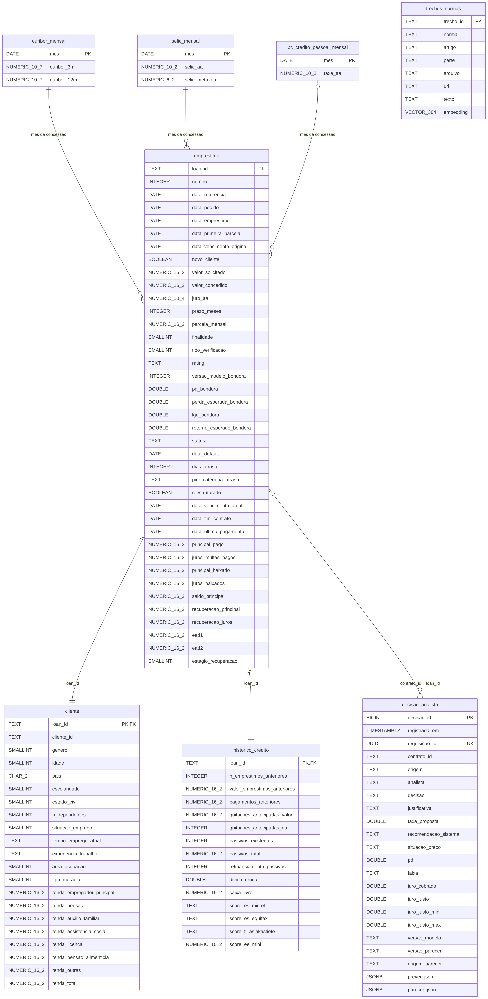
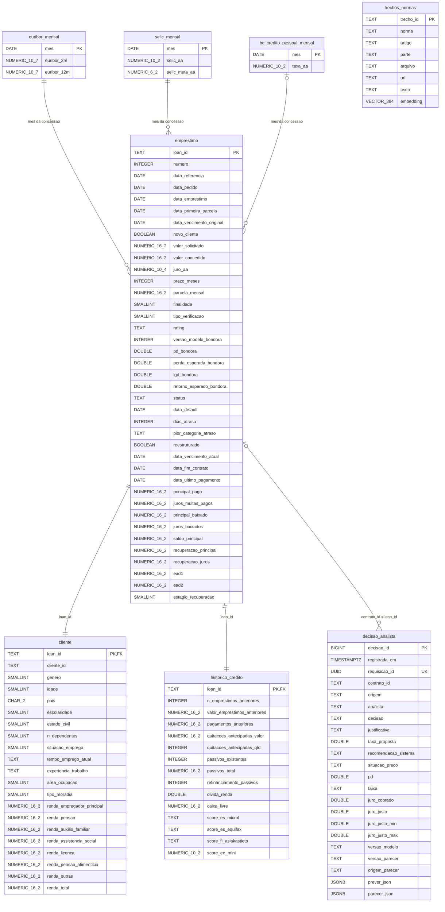

# DER do banco de dados

Diagrama entidade-relacionamento do PostgreSQL do projeto (`auditor_db`), gerado a partir dos arquivos `db/*.sql` e do `genai/src/indexar.py` em 16/11/2026.

O mesmo diagrama em Mermaid está no fim desta página (o GitHub o desenha) e em `der_banco.mmd`. Para regerar a imagem: `mmdc -i docs/der/der_banco.mmd -o docs/der/der_banco.png -b white -s 2`. Para conferir no DBeaver: botão direito no esquema `public` > View Diagram.

## Tabelas

| Tabela | Linhas | O que guarda | Arquivo |
| --- | --- | --- | --- |
| `emprestimo` | 179.235 | Um contrato da Bondora: termos, saídas do modelo da Bondora e desfecho | `db/01_schema_bondora.sql` |
| `cliente` | 179.235 | Perfil do tomador no momento do pedido; `cliente_id` é pseudonimizado | `db/01_schema_bondora.sql` |
| `historico_credito` | 179.235 | Dívidas e histórico de crédito antes do contrato, incluindo os scores de bureau | `db/01_schema_bondora.sql` |
| `euribor_mensal` | 393 | Euribor de 3 e 12 meses por mês (custo do dinheiro) | `db/02_schema_macro.sql` |
| `selic_mensal` | 484 | Selic por mês, só para contexto | `db/02_schema_macro.sql` |
| `bc_credito_pessoal_mensal` | 187 | Taxa média do crédito pessoal no Brasil (BC, série 20742), só para o parecer | `db/02_schema_macro.sql` |
| `decisao_analista` | cresce com o uso | Cada decisão do analista; só de inclusão (gatilhos bloqueiam alteração e exclusão) | `db/05_decisoes_analista.sql` e `db/07_normaliza_contrato_decisao.sql` |
| `trechos_normas` | um por trecho de norma | Trechos das normas com o vetor de 384 dimensões (pgvector) usado pelo RAG | `genai/src/indexar.py` |

## Relacionamentos

- `cliente` e `historico_credito` têm chave estrangeira para `emprestimo` (`loan_id`, 1 para 1, `ON DELETE CASCADE`).
- As três séries mensais se ligam a `emprestimo` pelo mês da concessão (`date_trunc('month', data_emprestimo)`). É uma ligação lógica, sem chave estrangeira, feita na view `vw_custo_do_dinheiro`. A série do BC começa em 03/2011, por isso um contrato pode não ter taxa do BC.
- `decisao_analista.contrato_id` aponta para `emprestimo.loan_id` sem chave estrangeira, de propósito: a tabela também guarda decisões de simulações (contratos digitados, como `EXEMPLO-1`). Um gatilho marca a origem (`carteira` ou `simulacao`) e normaliza o id para minúsculas.
- `trechos_normas` não se liga a nenhuma tabela: é a base de conhecimento do RAG.

## Views

| View | Para que serve | Arquivo |
| --- | --- | --- |
| `vw_custo_do_dinheiro` | Liga cada contrato à Euribor, à Selic e à taxa do BC do mês da concessão | `db/02_schema_macro.sql` |
| `vw_base_modelagem` | Contratos encerrados de 2009 a 2016, sem a Eslováquia, com o conjunto (treino, teste ou fora) | `db/03_view_modelagem.sql` |
| `vw_retorno_realizado` | Quanto cada contrato da base de modelagem devolveu em euros (backtest e ROI) | `db/04_view_retorno_realizado.sql` |
| `vw_decisao_atual` | A decisão mais recente de cada contrato da carteira (fila "já decidido") | `db/05_decisoes_analista.sql` |
| `vw_desfecho_contrato` | O desfecho de cada contrato ou o motivo de não ter | `db/06_view_desfecho_contrato.sql` |
| `vw_contrato_modelo` | A linha de cada contrato no formato que o `prever()` lê | `db/08_view_contrato_modelo.sql` |

Gênero, idade, estado civil e dependentes ficam só em `cliente` e não aparecem em nenhuma view lida pela API.

## Diagrama em Mermaid

